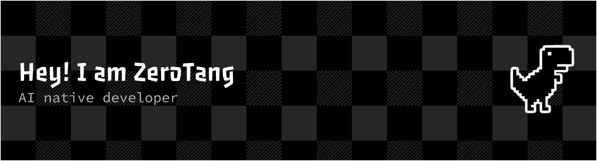
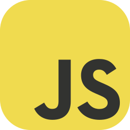
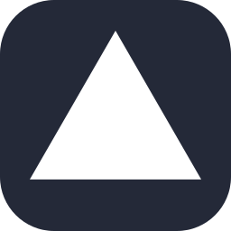
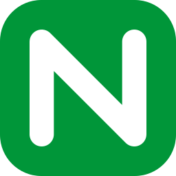
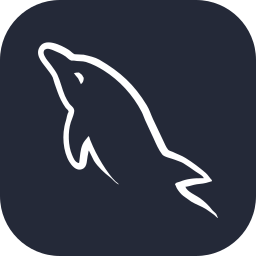
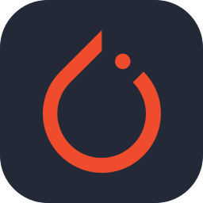
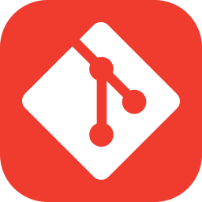
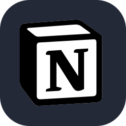

# 💫 About:
🎓 I’m a first-year graduate student at Southeast University 🔭 I’m continuously learning about LLMs, AI agents, and scalable AI systems 🤝 I’m open to collaborating on AI-driven products, LLM applications, and intelligent systems 💼 I’m seeking roles in AI product engineering, applied AI, or AI R&D

# 💻 Skills:
                     

# 📊 Stats:

## 💰 Support

## 📫 Connect

  
  
  
  
  

<!-- freelance-section -->
## 🛠 同时接单：AI 应用与全栈外包

除了找机会，我也接**外包项目**。下面是真实交付过的线上系统，点开就能看：

| 系统 | 说明 |
| --- | --- |
| [AI 海龟汤 · 实时多人情境推理](https://requirement-diagnoser.tangziye2.workers.dev/go?s=gh-profile-game&u=https%3A%2F%2Fsp.xiaobaozi.cn) | 446 题题库 + 实时多人房间 + LLM 判题（只回答「是 / 否 / 无关 / 无法确定」）。React 19 + NestJS + PostgreSQL + WebSocket，部署在自有服务器与 Cloudflare Workers，含微信支付 v3 与订阅授权账本 |
| [需求诊断台](https://requirement-diagnoser.tangziye2.workers.dev/go?s=gh-profile-diagnoser&u=https%3A%2F%2Frequirement-diagnoser.tangziye2.workers.dev%2F) | 贴一段需求 → 技术可行性 + 方案取舍 + 风险 + 阶段拆分 + 工期与报价区间，还能一键生成可直接发送的回复 |
| [接单服务目录与作品集](https://requirement-diagnoser.tangziye2.workers.dev/go?s=gh-profile-service&u=https%3A%2F%2Fzerotang-studio.pages.dev%2F) | 服务项、真实作品、买家向的价格文章，以及一份可验证的项目制履历 |
| [接单行情报告](https://requirement-diagnoser.tangziye2.workers.dev/go?s=gh-profile-market&u=https%3A%2F%2Fzerotang-studio.pages.dev%2Fmarket.html) | 用 440+ 个真实在招项目算出来的价格分布，每天自动重算——公开数据，不是拍脑袋 |

- **做什么**：AI 功能落地（判题 / 问答 / RAG / Agent 工作流 / 结构化输出与评测集）、全栈系统（React + NestJS + PostgreSQL + 管理后台）、实时多人协作（WebSocket）、支付与订阅、部署运维、账号鉴权。
- **怎么合作**：按可验收的里程碑固定价，先给能跑起来的第一版；代码、部署、文档一并移交，仓库可接手。
- **报价口径**：独立开发者人天约 ¥1200～¥2000（$150～$250），起价给到模块级，不报一口价。

有具体需求可以直接开 issue 描述，或看上面[需求诊断台](https://requirement-diagnoser.tangziye2.workers.dev/go?s=gh-profile-diagnoser&u=https%3A%2F%2Frequirement-diagnoser.tangziye2.workers.dev%2F)先免费评估一份。

<!-- /freelance-section -->
